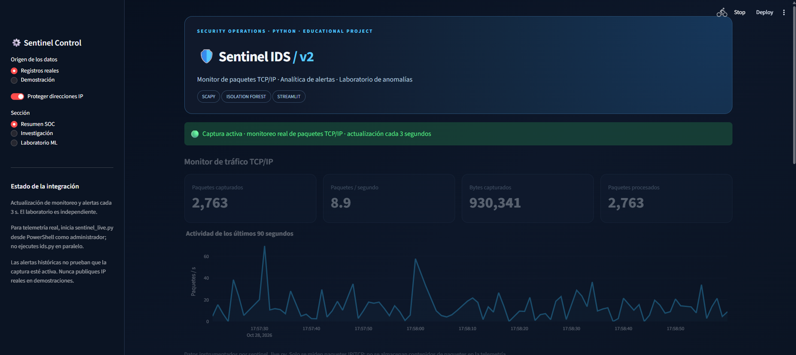
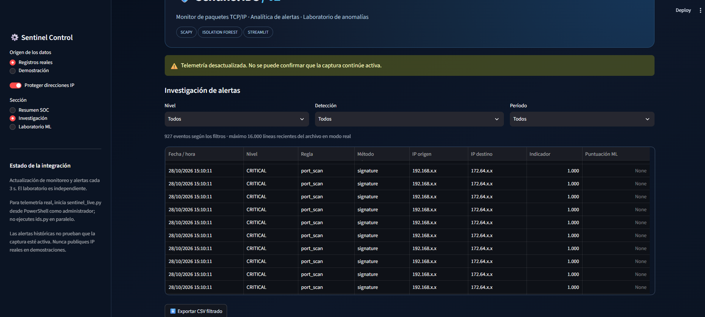
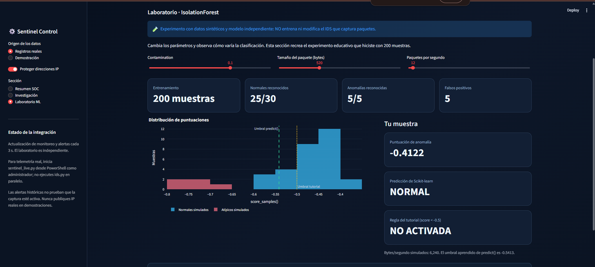
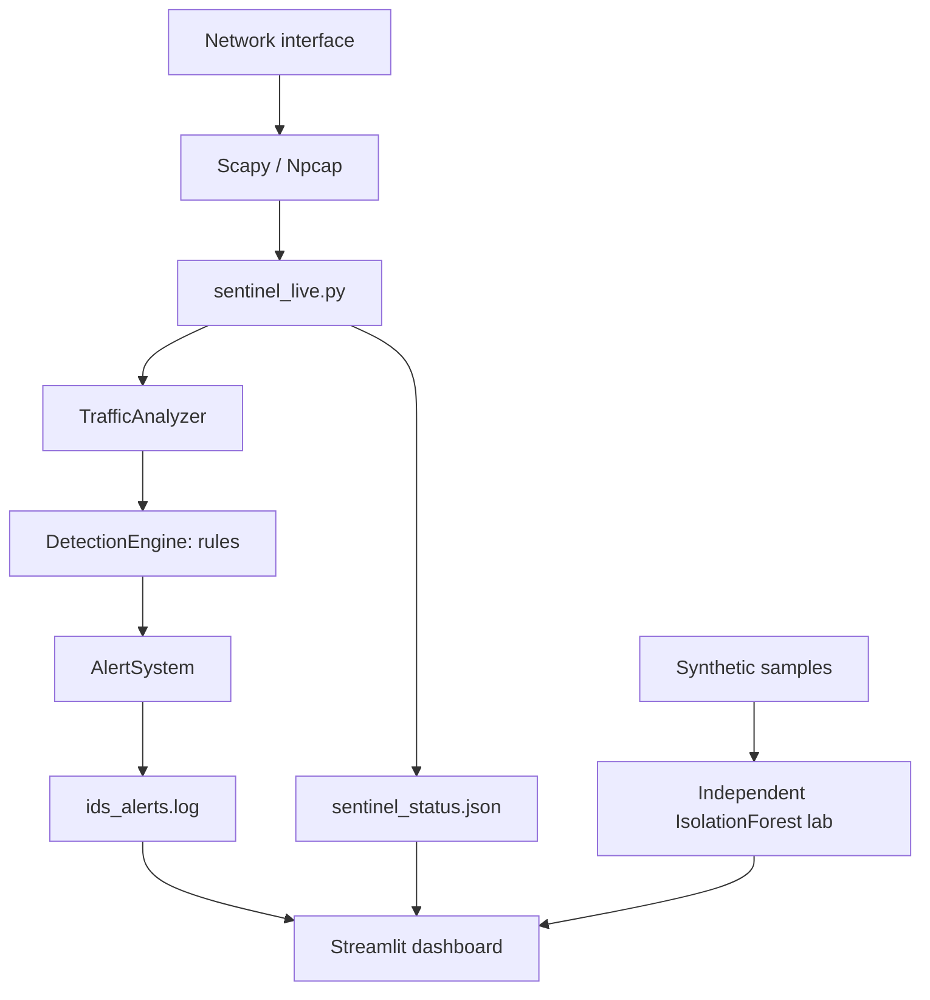

# Sentinel IDS — Real-Time Network Intrusion Detection & Security Monitoring

**An educational intrusion detection system (IDS) written in Python**, with a Streamlit security dashboard, live TCP/IP telemetry from Scapy, rule-based detection, alert investigation, and an interactive Isolation Forest anomaly-detection laboratory.

> **Learning project, not production security software.** The detection rules are intentionally simplified, can produce false positives, and cannot establish that an attack has occurred. Only capture traffic on systems or networks you own or have permission to monitor.

## Preview

| SOC overview | Alert investigation |
|---|---|
|  |  |



*Screenshots from local development. IPs are masked in the alert view. The ML lab uses synthetic data, independent of live network traffic.*

## What this project demonstrates

- **Traffic capture:** monitor IPv4/TCP packets with Scapy and Npcap on Windows.
- **Live operational telemetry:** view captured/processed packet counts, bytes, packets per second, and a rolling activity chart.
- **Rule-based alerts:** explore simplified SYN-flood and port-scan heuristics adapted from the freeCodeCamp tutorial.
- **Alert investigation:** read `ids_alerts.log`, collapse duplicate WARNING/CRITICAL records for the same event, filter alerts, and export masked results.
- **Anomaly detection:** train and experiment with `IsolationForest` using synthetic observations; compare `predict()` with the tutorial's fixed `score_samples() < -0.5` threshold.
- **Demo mode:** use fictional, non-sensitive telemetry and IPs when presenting the dashboard.

## Technology stack

| Layer | Tools |
|---|---|
| Language | Python 3 |
| Packet capture | Scapy, Npcap (Windows) |
| Intrusion heuristics | Rule-based checks in `DetectionEngine` |
| Machine learning | scikit-learn `IsolationForest`, NumPy |
| Monitoring UI | Streamlit, Pandas, Plotly |
| Testing | pytest, synthetic observations |

## Architecture



**Important distinction:** `sentinel_live.py` imports the existing analyzer, detection engine and alert system from `ids.py` and instruments packet capture. It writes local telemetry to `sentinel_status.json`. The **ML lab is independent**: it trains a model on synthetic samples and does **not** train or modify the live IDS engine.

## Quick start (Windows + VS Code)

### Prerequisites

- Python 3 and Git.
- Npcap installed on Windows for packet capture: https://npcap.com/#download
- A terminal with administrator privileges **only when capturing live network traffic**. The dashboard and demo mode normally do not need elevated permissions.

Clone or download this repository, open a terminal inside it, and create a virtual environment:

```powershell
py -m venv venv
.\venv\Scripts\Activate.ps1
python -m pip install -r requirements.txt
```

Launch the dashboard (works in **Demostración** mode without any capture process):

```powershell
python -m streamlit run dashboard.py
```

Open `http://localhost:8501` if Streamlit does not open it automatically. In the left sidebar, select **Demostración** for synthetic preview data, or **Registros reales** to load local telemetry and alerts.

### Start a live monitor (optional)

Stop any running `python ids.py` process before starting the instrumented monitor. In a **separate elevated PowerShell** window, navigate to the project, activate the virtual environment, and list the capture interfaces:

```powershell
.\venv\Scripts\Activate.ps1
python sentinel_live.py --list-interfaces
```

Use the **actual network interface index displayed on your machine** (do not assume it is always 18):

```powershell
python sentinel_live.py --interface-index <YOUR_INDEX>
```

Keep this terminal open while observing **Registros reales → Resumen SOC** in the dashboard. Generate ordinary web traffic on your own machine to observe counts. Stop the monitor with `Ctrl+C`.

**Running modes:**

- `python sentinel_live.py --interface-index <YOUR_INDEX>`: instrumented Scapy capture for the dashboard (live counters and logging).
- `python ids.py`: original tutorial-style IDS; logs alerts but does not provide dashboard packet telemetry. The sample `ids.py` retains a machine-specific interface setting for the author's environment and may need adjusting before standalone execution elsewhere.
- `python -m streamlit run dashboard.py`: local visualization; it does **not** automatically start packet capture.

## Tests

Install optional test dependencies and run the included automated checks:

```powershell
python -m pip install -r requirements-dev.txt
python -m pytest -q
```

The automated tests cover masking, de-duplication of alert records, monitoring state freshness, and the synthetic ML experiment. They do **not** establish production-grade detection accuracy.

## Repository layout

```text
Sentinel-IDS/
├── dashboard.py                # Streamlit SOC dashboard
├── sentinel_live.py            # Scapy capture + live telemetry
├── sentinel_data.py            # Log parser, telemetry and demo data
├── ml_experiment.py            # Synthetic Isolation Forest experiment
├── ids.py                      # Tutorial-based IDS engine
├── requirements.txt
├── requirements-dashboard.txt
├── requirements-dev.txt
├── tests/
│   └── test_sentinel.py
├── docs/
│   ├── images/
│   └── LIMITATIONS.md
├── .gitignore
└── README.md
```

## Learning outcomes

During implementation, I practiced:

1. Capturing packets and inspecting TCP/IP fields with Scapy.
2. Tracking per-flow packet and byte rates.
3. Debugging an initial divide-by-zero issue when the first flow duration was zero.
4. Training `IsolationForest` before calling its scoring methods.
5. Distinguishing anomalies, alerts, false positives and confirmed incidents.
6. Building a Streamlit dashboard with live telemetry and an isolated synthetic ML lab.

In a local **synthetic** validation run, the model classified **25/30 normal samples** as normal and **5/5 intentionally unusual samples** as anomalies. This is a learning demonstration, **not a real-world detection benchmark**.

## Limitations and responsible use

- The `port_scan` heuristic checks small packet size and high traffic rate; it does **not** correlate distinct destination ports and may over-report normal traffic.
- The `syn_flood` heuristic is similarly simplified and is not an incident confirmation.
- `CRITICAL` records in the original engine reflect a fixed signature confidence of `1.0`; they are not calibrated attack probabilities.
- The main live capture's IsolationForest model is **not trained automatically**. The dashboard's ML lab trains a separate model with **synthetic data only**.
- Telemetry freshness is used to show the **status of the monitoring process**, not proof that all traffic is captured.
- This project focuses on IPv4/TCP and is not intended to replace an IDS or SIEM used in a real security environment.
- Raw `.log`, `.pcap`, `.csv`, local telemetry and credentials must **not** be committed to the repository. `.gitignore` provides safeguards, but review `git status` before pushing.

See [detailed limitations](docs/LIMITATIONS.md) for additional discussion.

## Acknowledgments

This educational project started from the freeCodeCamp tutorial **[Build a Real-Time Intrusion Detection System with Python](https://www.freecodecamp.org/news/build-a-real-time-intrusion-detection-system-with-python/)**. The additional local monitoring dashboard, telemetry integration and synthetic ML experiment extend that learning exercise. The tutorial author/source should be credited when sharing derivative work.

## Project status

**Educational prototype · Windows-tested locally · Not independently audited**

This repository does not include a software license. Reuse permissions for third-party tutorial code and other components should be reviewed before selecting a license.
